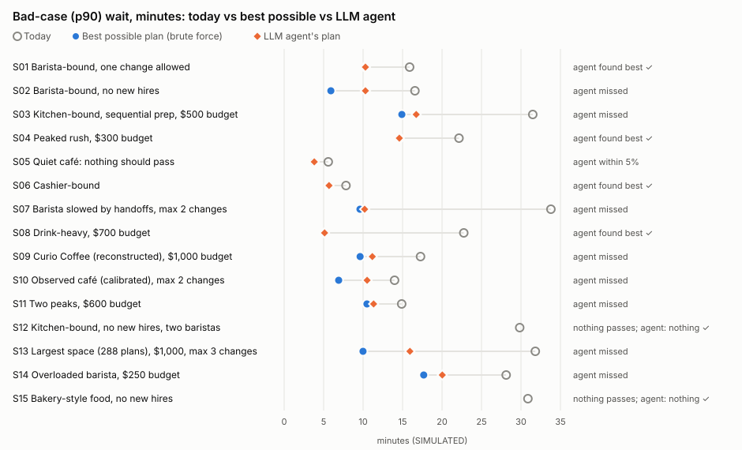

# Stage 3 evaluation results

All waits are **SIMULATED**. 13 of the 15 cafés are **SYNTHETIC** (invented for testing); S10 is the café calibrated on 18 observed orders and S09 is reconstructed from a 2025 class proposal. Method: [PROTOCOL.md](PROTOCOL.md). Scenarios and scoring were committed before any agent ran (commit `ca79299`).

## Headline

| | Found the best plan | Within 5% of best | Simulations used |
|---|---|---|---|
| LLM agent (gpt-oss-120b) | **6 of 15** | 7 of 15 | 365 |
| Greedy search (no LLM) | 15 of 15 | 15 of 15 | 714 |
| Brute force (every plan) | 15 of 15 (by definition) | 15 of 15 | 1488 |

- **The LLM agent is worse than a simple greedy search here.** It found the best plan in 6 of 15 scenarios; greedy found it in all 15. It used about half as many simulations (365 vs 714 for greedy, 1488 for brute force), partly because it often stopped early.
- **Why it missed (9 scenarios).** 5 runs stopped early: 19 times in all the model returned an empty reply (no text, no tool call) after reasoning, and the loop treats two empty replies in a row as "stop". 2 used the full experiment budget without trying the winning combination, and 2 chose to finish early. In 5 of the misses the agent's plan was part of the best plan, one or two changes short.
- **The acceptance rule held up: 0 false positives in 130 accepted plans.** Every plan the rule accepted still showed ≥10% improvement with a paired 95% CI above zero on a fresh seed with 5× the replications (smallest fresh improvement: 10.5%).
- **The agent never recommended a plan the rule rejected** (it cannot: recommendations come only from accepted experiments), and in the two scenarios where nothing passes (S12, S15) it correctly recommended nothing.
- **Model builder: 57 of 70 stated fields correct (81.4%), 0 invented.**

## Per scenario

p90 = overall 90th-percentile wait, minutes, SIMULATED (200 replications, seed 31337).

| Scenario | Plans | Today p90 | Best plan (brute force) | Best p90 | LLM agent plan | Agent p90 | Agent result | Agent sims | Greedy sims |
|---|---|---|---|---|---|---|---|---|---|
| S01 Barista-bound, one change allowed | 72 | 15.9 | +1 barista | 10.3 | +1 barista | 10.3 | best | 26 | 42 |
| S02 Barista-bound, no new hires | 72 | 16.6 | cashier → barista + grab-and-go 40% + batches of 6 every 20 min | 5.9 | cashier → barista | 10.3 | miss | 20 | 66 |
| S03 Kitchen-bound, sequential prep, $500 budget | 36 | 31.5 | parallel prep + +1 kitchen 07:15–08:00 | 14.9 | +1 kitchen 07:15–08:00 | 16.7 | miss | 25 | 54 |
| S04 Peaked rush, $300 budget | 48 | 22.1 | grab-and-go 30% | 14.6 | grab-and-go 30% | 14.6 | best | 7 | 6 |
| S05 Quiet café: nothing should pass | 32 | 5.6 | +1 barista + +1 kitchen + grab-and-go 30% | 3.7 | +1 barista + +1 kitchen | 3.8 | within 5% | 25 | 84 |
| S06 Cashier-bound | 36 | 7.8 | +1 barista | 5.7 | +1 barista | 5.7 | best | 31 | 66 |
| S07 Barista slowed by handoffs, max 2 changes | 32 | 33.8 | +1 barista + grab-and-go 30% | 9.6 | +1 barista | 10.2 | miss | 31 | 54 |
| S08 Drink-heavy, $700 budget | 24 | 22.8 | +1 barista | 5.1 | +1 barista | 5.1 | best | 22 | 24 |
| S09 Curio Coffee (reconstructed), $1,000 budget | 96 | 17.3 | parallel prep + +1 barista | 9.6 | +1 barista | 11.2 | miss | 27 | 54 |
| S10 Observed café (calibrated), max 2 changes | 32 | 14.0 | +1 barista + +1 kitchen | 6.9 | parallel prep + +1 kitchen | 10.5 | miss | 21 | 54 |
| S11 Two peaks, $600 budget | 24 | 14.9 | +1 kitchen second peak + grab-and-go 30% | 10.5 | +1 barista first peak (07:00–07:45) + grab-and-go 30% | 11.3 | miss | 19 | 42 |
| S12 Kitchen-bound, no new hires, two baristas | 48 | 29.8 | Nothing passes | — | Nothing | — | best | 32 | 30 |
| S13 Largest space (288 plans), $1,000, max 3 changes | 288 | 31.8 | +1 barista 07:30–08:15 + +1 kitchen + parallel prep | 10.0 | +1 kitchen + grab-and-go 20% | 15.9 | miss | 27 | 84 |
| S14 Overloaded barista, $250 budget | 36 | 28.1 | grab-and-go 50% | 17.7 | grab-and-go 30% | 20.0 | miss | 20 | 30 |
| S15 Bakery-style food, no new hires | 32 | 30.9 | Nothing passes | — | Nothing | — | best | 32 | 24 |

Agent stop reasons: no_tool_call 7, experiment_budget 4, finished 3, llm_call_limit 1.

## Model builder (10 descriptions)

| Case | Fields correct | Wrong or missing | Invented |
|---|---|---|---|
| B01 | 8 / 8 | — | — |
| B02 | 5 / 6 | staff.kitchen (expected 0, got nothing) | — |
| B03 | 3 / 7 | mixPercent.drink (expected 50, got 0.5); mixPercent.food (expected 20, got 0.2); mixPercent.drinkFood (expected 30, got 0.3); prepMode (expected "sequential", got nothing) | — |
| B04 | 7 / 7 | — | — |
| B05 | 5 / 6 | staff.barista (expected 1, got nothing) | — |
| B06 | 4 / 4 | — | — |
| B07 | 4 / 8 | staff.kitchen (expected 0, got nothing); mixPercent.drink (expected 100, got nothing); mixPercent.food (expected 0, got nothing); mixPercent.drinkFood (expected 0, got nothing) | — |
| B08 | 7 / 10 | mixPercent.drink (expected 40, got nothing); mixPercent.food (expected 30, got nothing); mixPercent.drinkFood (expected 30, got nothing) | — |
| B09 | 5 / 5 | — | — |
| B10 | 9 / 9 | — | — |

Patterns: (1) stated zeros are dropped ("no kitchen staff", "drinks only"); (2) in B03 the mix came back as fractions (0.5, 0.2, 0.3) instead of percentages. That scores as wrong under the locked rules, but the simulator treats the mix as relative weights, so the café built is the same; (3) one missed "drink first, then food".

## Cost

LLM agent: 450,172 tokens; OpenRouter reported $0.0408 per call in total (account balance delta $0.0308). Model builder: $0.0016. Model: gpt-oss-120b via OpenRouter, pinned to Groq, fallbacks disabled.

## Changes after locking

None to scenarios, scoring or the agent. One observation: **S05 did not behave as designed.** It was meant as "nothing should pass", but its bad-case wait is short (5.6 min), so a 10% cut is about half a minute and 15 plans passed. It is scored against the brute-force truth like every other scenario.

## Post-lock run (Addendum 1)

Run after the results above, with the changes committed beforehand in [PROTOCOL.md](PROTOCOL.md) Addendum 1. Results above are unchanged.

### 1. Agent loop retries empty replies (same 15 scenarios)

| | Best plan found | Within 5% | Simulations | Tokens |
|---|---|---|---|---|
| Original run | 6 of 15 | 7 of 15 | 365 | 450,172 |
| Post-lock run 1 (retries; 4 runs cut short by Groq rate limits) | 7 of 15 | 8 of 15 | 331 | 428,144 |
| **Post-lock run 1b (retries + rate-limit backoff; clean)** | **6 of 15** | 7 of 15 | 364 | 495,473 |
| Greedy (no LLM) | 15 of 15 | 15 of 15 | 714 | — |

**Retrying empty replies did not help.** In the clean run (1b), 20 empty replies were retried successfully and runs now end at the experiment budget or by choice (stop reasons: experiment_budget 7, no_tool_call 2, finished 6), but the outcome changed in 0 of 15 scenarios. Early stopping was not what cost the agent; its choice of which plans to test is. Run 1 scored one more because of run-to-run variation (S14 was solved in run 1 and missed in 1b), which also shows results vary between runs even at temperature 0.

### 2. Five interacting-changes scenarios (locked before running)

| Scenario | Mechanism | Plans | Best plan (brute force) | Greedy | LLM agent |
|---|---|---|---|---|---|
| I1 Twin bottleneck, max 2 changes | superadditive | 36 | +1 barista + +1 kitchen (p90 2.9, today 11.7) | +1 barista + +1 kitchen: best | +1 barista + +1 kitchen: best |
| I2 Twin bottleneck, no new hires, three on the register | superadditive | 24 | cashier → barista + cashier → kitchen (p90 3.0, today 11.8) | cashier → barista + cashier → kitchen: best | cashier → barista + cashier → kitchen + grab-and-go 30%: within 5% |
| I3 Twin bottleneck at the peak, $500 budget | superadditive | 16 | +1 barista 07:30–08:00 + +1 kitchen 07:30–08:00 (p90 5.5, today 10.2) | +1 barista 07:30–08:00 + +1 kitchen 07:30–08:00: best | +1 barista 07:30–08:00: miss |
| I4 Budget trap: whole-rush barista vs two peak extras, $700 | budget trap | 24 | +1 barista 07:30–08:00 + +1 kitchen 07:30–08:00 + grab-and-go 30% (p90 4.3, today 8.3) | +1 barista whole rush: miss | +1 barista whole rush: miss |
| I5 Budget trap at a twin peak, $660 | budget trap | 18 | +1 barista 07:30–08:00 + +1 kitchen 07:30–08:00 (p90 5.5, today 10.2) | +1 barista whole rush: miss | +1 barista whole rush: miss |

- **Greedy: 3 of 5.** It solved the three superadditive scenarios (each single fix still clears 10% on its own, so greedy takes it and then adds the other) and fell into both budget traps, as designed.
- **LLM agent: 1 of 5 (within 5%: 2).** It also fell into both budget traps and never tested the winning pair (peak barista + peak cook) in I3, I4 or I5. Simulations: agent 106, greedy 198, brute force 360.
- **The LLM did not beat greedy anywhere in this evaluation** (20 scenarios). Brute force is cheap at this size (118 plans in seconds), which is why the Stage 4 design uses it.
- **Acceptance-rule false positives: 7 of 37 accepted plans** here (0 of 130 on the original set). All are borderline: accepted at 10–13% and re-measured at 6–10% on the fresh seed, with the CI still above zero (real improvements just under the bar). None is a best plan. One is the LLM agent's I3 recommendation (peak barista alone). Fix in Stage 4: re-check the final recommendation on a fresh seed with 1,000 replications before showing it.

| Scenario | Plan | Improvement (search) | Improvement (fresh check) |
|---|---|---|---|
| I1 | +1 barista 07:30–08:00 | 10.9% | 9.0% |
| I1 | +1 barista 07:30–08:00 + grab-and-go 30% | 10.9% | 9.0% |
| I3 | +1 barista 07:30–08:00 | 13.0% | 9.8% |
| I3 | +1 barista 07:30–08:00 + +1 cashier 07:30–08:00 | 10.2% | 6.3% |
| I3 | +1 barista 07:30–08:00 + grab-and-go 30% | 13.0% | 9.8% |
| I5 | +1 barista 07:30–08:00 | 13.0% | 9.8% |
| I5 | +1 barista 07:30–08:00 + grab-and-go 30% | 13.0% | 9.8% |

### 3. Model builder after the stated-zeros fix

| Cases | Before fix | After fix | Invented |
|---|---|---|---|
| B01–B10 (seen while writing the fix) | 57 / 70 (81.4%) | 67 / 70 (95.7%) | 0 |
| H01–H05 (held out, the fair test) | not run | **36 / 38 (94.7%)** | 1 |

Remaining errors: the model often gives a handoff head count but leaves out the handoff mode (now inferred in code: a stated handoff person means a dedicated handoff point; scores above are unchanged), and in H03 it filled in a handoff head count nobody stated.

### 4. Diagnostic: wait vs time in café

"Wait" starts when the order is placed (matching how the 18 observed orders were timed), so a plan could shorten it by holding customers longer in the order line. Checked after locking: of 167 accepted plans across both sets, **0 made time in café (arrival → order received) worse**. The flip side shows up in display, not decisions: in S06, adding a cashier makes "wait" about 67% longer but time in café about 7% shorter, because people leave the order line sooner and wait at pickup instead. Stage 4 shows both numbers.

LLM cost: OpenRouter account usage after all Stage 3 runs $0.19 of $5 (both addenda together about $0.10).

## Limitations

- **Synthetic scenarios.** 18 of 20 cafés are invented; real cafés may have larger or messier option spaces.
- **Small n.** 20 scenarios, one LLM run each per configuration. The model runs at temperature 0, but outputs can still vary run to run; no repeat runs were made.
- **Small change spaces favour greedy.** With 24–288 plans and mostly independent levers, step-by-step search is close to exhaustive. The comparison says little about large or tightly coupled spaces.
- **Calibration on 18 orders.** The only real-data café (S10) is calibrated on 18 observed orders from one session, and its drink + food waits run about 5.6 min short of what was observed.
- **False-positive check is within the model.** It tests whether accepted plans survive simulation noise, not whether they work in a real café.
- **Model builder scoring is strict** (exact fields); it does not score whether a wrong field changes the café built.
